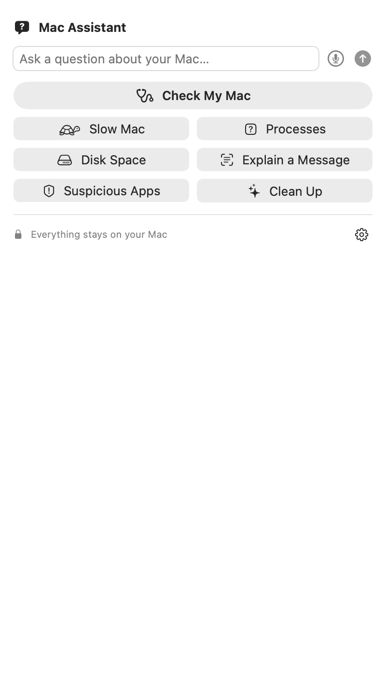
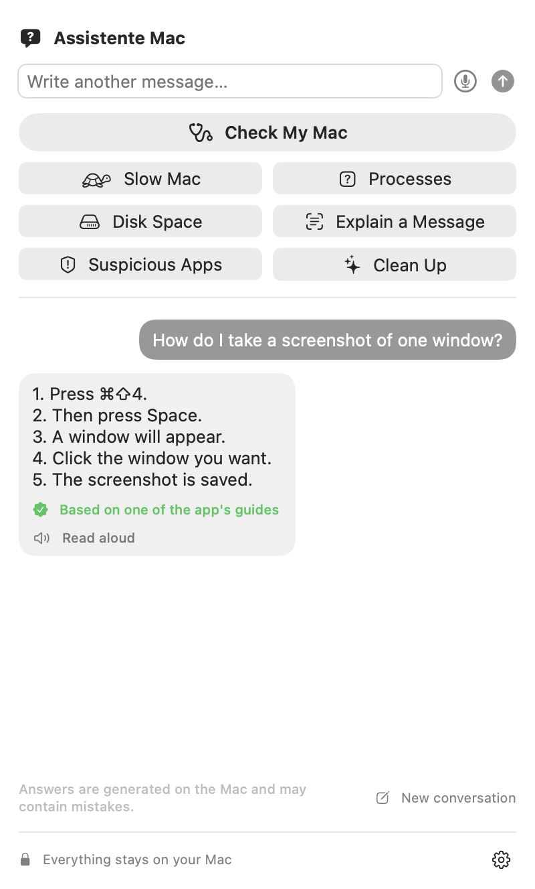
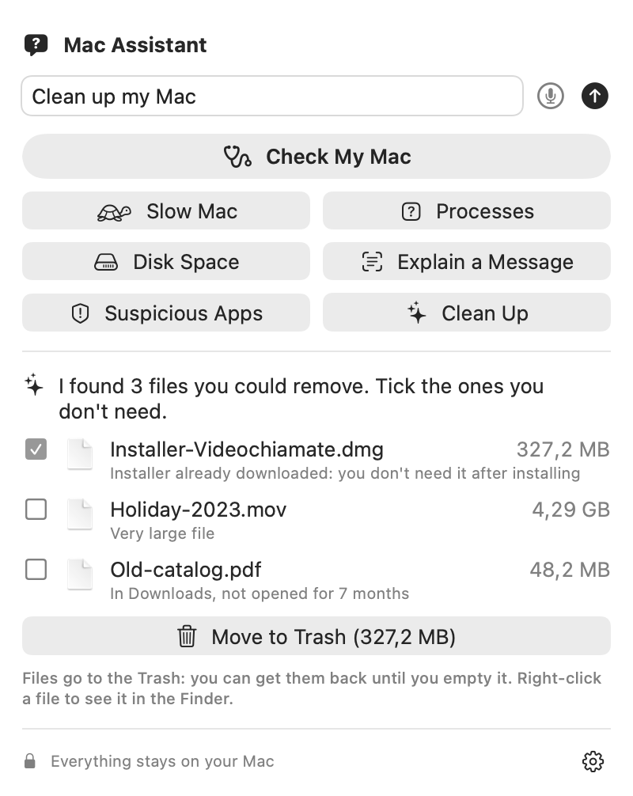
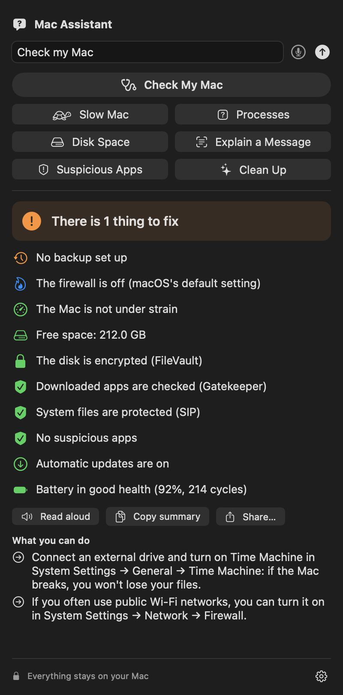
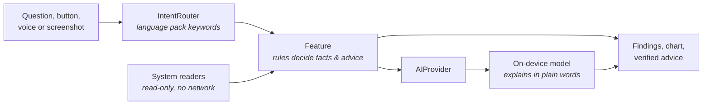

<p align="center">
  
</p>

<h1 align="center">Mac Assistant</h1>

<p align="center">
  <b>A friendly Mac assistant that lives in your menu bar.</b><br>
  Ask about your Mac in your own language and get a clear answer — <b>100% on-device</b>.
</p>

<p align="center">
  
  
  
  
  
</p>

<p align="center">
  <a href="https://github.com/AlexVittorioCastellano/mac-assistant/releases/latest/download/MacAssistant.zip"><b>Download for Mac</b></a> ·
  <a href="https://alexvittoriocastellano.github.io/mac-assistant/">Website</a> ·
  🇬🇧 <a href="#english">English</a> · 🇮🇹 <a href="#italiano">Italiano</a>
</p>

<p align="center">
  
</p>

---

<a id="english"></a>

## Why

Most people don't know why their Mac is slow, what `kernel_task` is, where 60 GB of
"System Data" came from, or whether that scary pop-up is real. Mac Assistant answers
those questions in plain language, **without sending anything off your Mac**, without an
account and without API keys.

It's built for non-experts — and it's careful: it reads your system, explains what it
finds, and suggests what *you* can do. It never quits apps or deletes files on its own.

## What it does

| | |
|---|---|
| 🩺 **Check My Mac** | One-click traffic light: speed, disk space, Time Machine backup, FileVault, Gatekeeper, SIP, firewall, updates, battery health, suspicious apps. Copy or share a plain summary with whoever helps you. |
| 🐢 **Slow Mac** | Reads CPU, memory pressure, temperature and processes, then explains what's going on. Never suggests quitting macOS processes. |
| ❓ **What is this process?** | Tells you what a process is, whether it belongs to macOS or an app (verified via its code signature) and whether it's safe to quit — with app icons. |
| 💾 **Where did my space go?** | Donut chart of used space: Apple Intelligence models, apps, Photos, Downloads, caches… and what "System Data" really is. |
| ✨ **Guided cleanup** | Suggests used installers, forgotten downloads and huge files. You tick and confirm; files go to the **Trash** (recoverable) and you can undo. |
| 🛡️ **Suspicious apps** | Checks background items and app signatures (verified developer, unsigned, broken signature) and known unwanted software, and explains how to remove them. |
| 📸 **Explain a message** | Screenshot any alert (⌃⇧⌘4) and press the button: the text is read on-device and explained. **Tech-support scams are flagged** in any language. |
| 💬 **Free chat** | "How do I…?" questions, backed by ~40 verified guides per language so shortcuts and menu names are right. |
| 🔔 **Alerts before it's too late** | A notification when a problem *lasts* (an app hogging the CPU for 10 minutes, memory exhausted, overheating, disk almost full). |
| 🎤 **Ask by voice · 🔊 read aloud** | On-device speech recognition and speech synthesis. |
| ⌨️ **Always at hand** | Menu bar icon or **⌥Space** from any app; opens at login if you want. |

<p align="center">
  
  
  
</p>

## Privacy

- **Everything runs on your Mac**: Apple's on-device Foundation Models (Apple Intelligence),
  Vision for reading screenshots, SpeechAnalyzer for your voice.
- **No network, no telemetry, no account, no API keys.** System checks use read-only tools
  and never contact any server (we deliberately skip `softwareupdate` and notarization
  checks because they would).
- The only feature that touches files is the guided cleanup, and only after you confirm:
  files go to the Trash, inside your home folder only, and the last cleanup can be undone.

## Requirements

- macOS 27 or later on Apple Silicon
- Apple Intelligence turned on (System Settings → Apple Intelligence & Siri).
  Without it you still get every check, chart and piece of advice — just not the
  AI-written explanation.

## Download

Grab **[MacAssistant.zip](https://github.com/AlexVittorioCastellano/mac-assistant/releases/latest/download/MacAssistant.zip)**
from the [latest release](https://github.com/AlexVittorioCastellano/mac-assistant/releases/latest), unzip it and move
**Mac Assistant** to Applications. The app isn't notarized yet: the first time, macOS asks you to confirm in
**System Settings → Privacy & Security → Open Anyway**.

## Build and run

You only need the **Command Line Tools** (`xcode-select --install`); Xcode is optional.

```sh
git clone https://github.com/AlexVittorioCastellano/mac-assistant.git
cd mac-assistant
./scripts/crea-app.sh                 # builds "build/Mac Assistant.app"
open "build/Mac Assistant.app"
```

Tip: move `Mac Assistant.app` to **Applications** before turning on "Open when the Mac starts".
The app is ad-hoc signed (not notarized yet): the first time, open it with right-click → Open.

For development:

```sh
swift run AssistenteMac                          # run the menu bar app
swift run assistente-cli "Why is my Mac slow?"   # try any feature from the terminal
swift run assistente-cli --chat "How do I take a screenshot?"
./scripts/test.sh                                # unit tests (fast, no AI)
swift run assistente-cli --eval Evals/en.json    # quality evals with the real model
./scripts/screenshot.sh                          # regenerate README images (fake demo data)
```

## How it works



**The code computes the facts; the AI only explains them.** The on-device model is small,
so numbers, verdicts ("can I quit this?"), advice and keyboard shortcuts come from
deterministic, tested rules and verified guides. The model turns them into friendly
sentences — and a safety net checks that it didn't change a shortcut.

```
Sources/
  AssistenteCore/      logic, no UI (testable)
    System/            read-only system data: processes, disk, signatures, security status, OCR, voice
    AI/                AIProvider protocol + LocalProvider (on-device)
    Features/          one file per feature: rules, prompts, routing
    Languages/         one JSON language pack per language
  AssistenteMac/       SwiftUI menu bar app
  assistente-cli/      terminal tool for developers (+ quality evals)
Tests/                 unit tests (Swift Testing)
Evals/                 quality evals with the real model, per language
```

The AI sits behind the `AIProvider` protocol, so an optional cloud provider could be added
later through a separate backend — the client would never contain API keys.

## Languages

The app follows your Mac's language (or pick one from the gear → Language), falling back to
English. **Italian and English** are available today. The on-device model supports about 15
languages, so many more are possible.

Everything language-dependent lives in `Sources/AssistenteCore/Languages/<code>.json`:
UI texts, the keywords used to understand questions, verified guides, process notes,
known macOS messages and scam patterns. **To add a language** (a native speaker is needed —
a badly translated guide is worse than no guide):

1. copy `en.json` to `<code>.json` and set `code`, `name`, `locale`;
2. translate `strings`, keeping `{0}`, `{1}` placeholders;
3. rewrite the `router` and guide `keywords` natively (word stems, verb forms, synonyms);
4. use the **exact** macOS menu names in that language;
5. run `./scripts/test.sh` (it checks keys and placeholders match English);
6. add `Evals/<code>.json` and run `swift run assistente-cli --eval Evals/<code>.json`.

## Quality

- **79 unit tests**, including real on-device OCR, speech transcription and moving files to
  the Trash and back.
- **Quality evals with the real model**: 144/144 cases in Italian, 52/52 in English —
  routing, verified guides, exact shortcuts, follow-up questions, off-topic questions,
  scams. Many cases were written as "unseen" questions to measure generalization.

## Contributing

Contributions are very welcome — no Swift needed for many of them:

- add or improve **verified guides** (`guides` in a language pack) — check your keywords with
  `swift run assistente-cli --guide "your question"`;
- add **process notes** (`processes`) or **known macOS messages / scam patterns** (`messages`);
- **add a language** (see above);
- found a question the app answers badly? Add it to `Evals/<code>.json` — that's the best way
  to make sure it never gets it wrong again.

Rules of the project: plain language, no jargon; never quit processes or delete files without
explicit confirmation; nothing leaves the Mac in local mode; no telemetry; never commit keys,
tokens or private URLs. Run `./scripts/test.sh` before opening a pull request.

## Roadmap

- More languages (community)
- Developer ID signing and notarization, downloadable releases
- Optional cloud plan through a separate backend (sign in with Apple; no keys in the client)

## License

[MIT](LICENSE) © 2026 Alex Castellano

---

<a id="italiano"></a>

## 🇮🇹 Italiano

**Mac Assistant** è un assistente per il Mac che vive nella barra dei menu. Fai una domanda
sul tuo Mac **nella tua lingua** e ricevi una risposta chiara, **tutto sul Mac**: niente dati
inviati, niente account, niente chiavi API. È pensato per chi non è esperto e non tocca nulla
da solo: legge, spiega e suggerisce.

<p align="center">
  
</p>

<p align="center">
  <a href="https://github.com/AlexVittorioCastellano/mac-assistant/releases/latest/download/MacAssistant.zip"><b>Scarica per Mac</b></a> ·
  <a href="https://alexvittoriocastellano.github.io/mac-assistant/">Sito</a>
</p>

### Cosa fa

- 🩺 **Controlla il mio Mac**: un semaforo su velocità, spazio, backup, FileVault, Gatekeeper,
  SIP, firewall, aggiornamenti, batteria e app sospette; riepilogo da copiare o condividere
  con chi ti aiuta.
- 🐢 **Mac lento**, ❓ **cos'è questo processo** (e se si può chiudere, verificato con la firma
  digitale), 💾 **dove è finito lo spazio** (con grafico e i "Dati di sistema" spiegati).
- ✨ **Pulizia guidata**: proposte, tu confermi, i file vanno nel **Cestino** e puoi annullare.
- 🛡️ **App sospette**: programmi in background, firme, software indesiderato noto.
- 📸 **Spiega un messaggio**: screenshot con ⌃⇧⌘4 → spiegazione; **le truffe vengono
  smascherate** in qualunque lingua.
- 💬 **Chat** con ~40 guide verificate per lingua, 🔔 **avvisi** quando un problema dura,
  🎤 **domanda a voce**, 🔊 **lettura ad alta voce**, ⌨️ **⌥Spazio** da qualunque app.

### Scaricare l'app

Scarica **MacAssistant.zip** dall'[ultima versione](https://github.com/AlexVittorioCastellano/mac-assistant/releases/latest),
estrailo e sposta **Mac Assistant** in Applicazioni. L'app non è ancora notarizzata: la prima volta macOS chiede
una conferma in **Impostazioni di Sistema → Privacy e sicurezza → Apri comunque**.

### Requisiti e installazione

macOS 27 o successivo con Apple Silicon e Apple Intelligence attiva (senza, restano tutti i
controlli e i consigli, ma non la spiegazione scritta dall'AI). Bastano i Command Line Tools:

```sh
git clone https://github.com/AlexVittorioCastellano/mac-assistant.git
cd mac-assistant
./scripts/crea-app.sh && open "build/Mac Assistant.app"
```

Sposta l'app in **Applicazioni** prima di attivare "Apri all'accensione". L'app non è ancora
notarizzata: la prima volta aprila con clic destro → Apri.

### Privacy

Il modello AI (Apple Intelligence), la lettura degli screenshot (Vision) e la voce
(SpeechAnalyzer) lavorano sul Mac. Nessuna rete, nessuna telemetria. L'unica funzione che
sposta file è la pulizia, solo dopo la tua conferma, solo nel Cestino e solo nella tua
cartella utente.

### Come contribuire

Guide verificate, note sui processi, messaggi noti di macOS e nuove lingue si aggiungono nei
file `Sources/AssistenteCore/Languages/<codice>.json`, senza toccare il codice (vedi
[Languages](#languages)). Prima di una pull request: `./scripts/test.sh` e, se tocchi chat o
guide, `swift run assistente-cli --eval Evals/it.json`. Se trovi una domanda a cui l'app
risponde male, aggiungila alle prove: è il modo migliore perché non sbagli più.

Regole: linguaggio semplice e senza gergo; mai chiudere processi o cancellare file senza
conferma esplicita; nessun dato lascia il Mac; niente telemetria; mai chiavi o segreti nel
repository.

### Licenza

[MIT](LICENSE) © 2026 Alex Castellano
